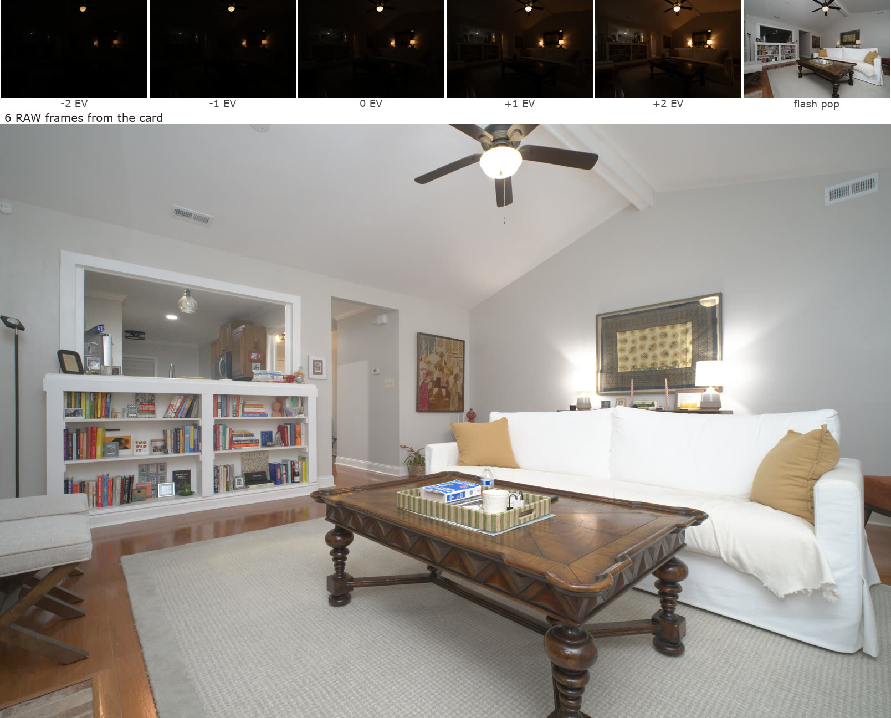
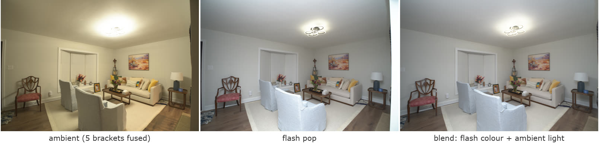
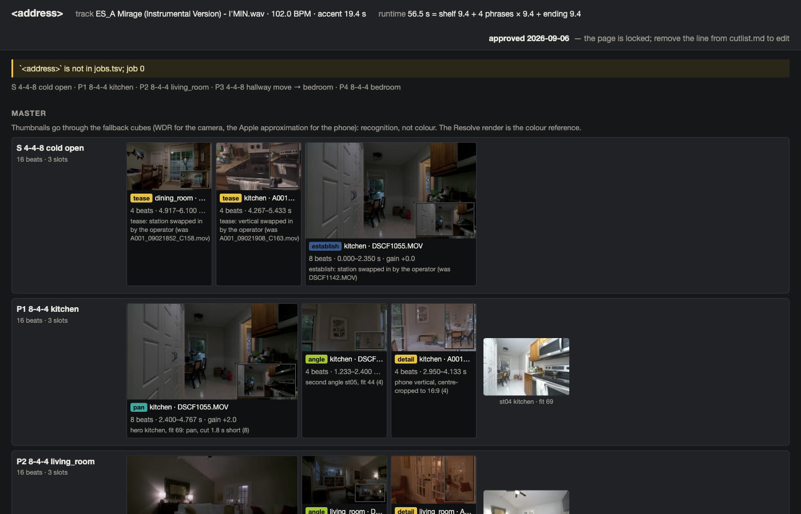

# re — real-estate photo tooling

One Rust binary (`retool`) with four jobs, built to iterate on real-estate
photography craft. The process it serves — one stale listing in, one relaunch
out, and the feedback loop around it — is `PROCESS-media-machine.md`; the
on-site checklist for whoever holds the camera is `RUNBOOK-shoot.md`.

1. **Edit**: turn each shot station (5-frame exposure bracket + flash pop)
   into a finished bright/airy listing photo — the thing an outsourced
   editor would charge ~$1/image for.
2. **Comply**: check every card against the shooting recipe (bracket
   ladders, ISO, shutter rules, WB) from EXIF alone.
3. **Judge**: score photos against a "realm" of curated reference images —
   for culling, ranking alternates, and tracking skill over time.
4. **Cut**: assemble the listing video and three reels from the card's
   clips on a music track's grid (`retool clips` → `plan`; PLAN-video-cut.md),
   put the plan in front of the operator as a page with thumbnails
   (`retool review`: swap, slip, reorder, drop, revive, approve;
   PLAN-review.md), and hand the approved cut over as a DaVinci Resolve
   project for QC and the render (`retool resolve` →
   `tools/resolve_build.py`; RESEARCH-resolve-handoff.md). `retool cut` is
   the ffmpeg fallback when Resolve is not there.

## What it outputs

**One station in, one listing photo out.** The camera shoots a 5-frame
exposure bracket and one flash pop per room. `retool run` groups the card
into stations, fuses the bracket, blends in the flash, corrects the lens,
straightens the verticals and tones the result. No hand editing:



**The blend.** The fused bracket has the room's real light but a yellow
cast; the flash has clean colour but flat light. The blend takes colour
from the flash and luminance from the ambient, in linear light:



**The card gate.** Before leaving the house, `retool card` checks every
frame against the shooting recipe from EXIF alone, in seconds:

```
$ retool card jobs/2026-09-02_test-house/card
90 frames -> 15 stations
st01 [OK  ] 5 brk 1 pop 0 det
st02 [OK  ] 5 brk 1 pop 0 det
...
st15 [OK  ] 5 brk 1 pop 0 det
CARD: 15 complete stations, 0 partial, 0 with recipe deviations -> CLEAN
DSCF1055.MOV: still:0.0-2.4,pan:2.4-6.6,still:6.6-10.0
DSCF1142.MOV: still:0.0-0.4,pan:0.4-1.2,still:1.2-2.9,pan:2.9-3.6,push:3.6-4.2,...
```

**The video plan.** The card's clips are segmented by motion, typed by room,
and laid on the chosen music track's beat grid. The review page shows the
plan with thumbnails; the operator swaps, slips or drops shots, then
approves, and the approved cut becomes a DaVinci Resolve project:



Client job folders, raw cards, music and the reference photo corpus are
not in this repo; the images above come from a test shoot.

## Setup (once)

```sh
brew install rustup exiftool ffmpeg && rustup default stable
brew install --cask hugin && xattr -dr com.apple.quarantine /Applications/Hugin
cargo build --release
unzip -j ~/Downloads/F-Log2_LUT_E_Ver.1.06.zip 'F-Log2_LUT_E_Ver.1.06/X-H2/*' -d luts   # Fuji cubes for retool cut
```

Notes:
- `exiftool` is required (EXIF grouping + recipe checks).
- enfuse comes from the Hugin cask; the real binary is inside
  `HuginStitchProject.app` (the `tools_mac/enfuse` symlink is dangling —
  the path is hardcoded in `src/main.rs`). The `xattr` strip is needed or
  macOS Gatekeeper SIGKILLs it.
- The first `realm` command downloads DINOv2 weights (~330MB, one-time) to
  `~/.cache/retool/`.

### The pages on the phone

A launchd agent (`tools/com.showready.re.plist`, installed to
`~/Library/LaunchAgents/`) serves this folder on `127.0.0.1:8791`, and
`tailscale serve --bg --https=8791 http://127.0.0.1:8791` puts it on the
tailnet, next to the deck (8765) and the ShowReady app (443):

```
https://<your-machine>.<tailnet>.ts.net:8791/SHOOT-SHEET.html
https://<your-machine>.<tailnet>.ts.net:8791/jobs/<job>/out/video/review.html   (read-only; Save/Approve need `retool review`)
```

Restart after a Python upgrade: `launchctl kickstart -k gui/$(id -u)/com.showready.re`.
Log: `~/Library/Logs/showready-re.log`.

## The shoot-night workflow

```sh
./target/release/retool card RAW                         # at the door: gate the card (seconds); video gate too when ../video exists
./target/release/retool run RAW out                      # process the whole card (+ video: clips → plan → review.html when ../video exists; stops at the plan)
./target/release/retool review <job> out                 # the plan with thumbnails: swap/slip/reorder/drop/revive, Save, Approve → the Resolve project
./target/release/retool resolve <job> out --render all   # the same build from the shell (needs `approved:`), rendered without the QC pass
./target/release/retool deliver realm.json out delivery  # ordered 2048px gallery + coverage + the video package
./target/release/retool realm score realm.json out       # rank / cull
```

`card` groups frames into stations by timestamp (a bracket burst absorbs its
trailing flash pops, and any longer-lens detail frames shot within four
minutes; a pop-less bracket re-shot within a minute is a re-meter and only
the last one counts) and prints a per-station **compliance report** against
the recipe (ladder ±2EV, bracket ISO 125, metered frame 1/30s or slower, pop
at ISO 320) plus a verdict line (`CLEAN` / `REVIEW`). It reads EXIF only, so
it runs in seconds on the laptop before leaving the house.

`run` does the same, then processes every complete station (5 brackets + pop)
into one flat folder:

| File | What it is |
|---|---|
| `out/stNN.jpg` | the final for station NN: fused ambient + flash blend + geometry + tone, full resolution |
| `out/stNN_dK.jpg` | detail K of station NN (a frame on the 18-50 longer than the room's bracket lens, within 4 min of the station): developed from that one frame, same geometry and tone |
| `out/scorecard.md` | a card per image: realm type + fit, verticals rotation/crop, blend and tone gains, recipe notes, review flags; room coverage at the top |
| `out/.meta/stNN.json` | what the machine measured for that station (the scorecard's source) |

The scorecard needs `realm.json` in the working directory, so run from the
repo. Nothing else is written: no per-stage diagnostics. To see what the
pop or the ambient stack contributes on its own, use the single-stage
commands below.

`deliver` types each final with the realm, orders the gallery the way an MLS
listing reads (exterior → living → dining → kitchen → bedrooms → baths →
outdoor), writes `NN_type.jpg` at 2048px sRGB q92, and reports which required
room types are missing.

Already-processed stations (existing `stNN.jpg`) are skipped, so re-running
on a growing card is cheap. Incomplete stations are listed but not processed.

With a `video/` folder beside the card, `run` continues into `clips` →
`plan` and stops there: the plan (`out/video/cutlist.md`, `reel_01..03.md`
and `review.html`, a read-only view of them with thumbnails) is that step's
deliverable. Nothing is built until the cutlist carries `approved: <date>`,
written by the review page's Approve or by hand; Approve also builds the
Resolve project (PLAN-review.md). `plan` refuses to overwrite an approved
cutlist unless `--replan`, which discards the approval; `cut`, `resolve` and
`tools/resolve_build.py` refuse a cutlist without one unless `--unapproved`
(the synthetic card's test path).

### Pipeline stages (also runnable individually)

```sh
retool fuse  <out_dir> <bracket.RAF>...     # rawler develop → 16-bit TIFFs → enfuse
retool dev   <out_dir> <frame.RAF>...       # develop RAFs to 16-bit TIFF
retool blend <flash.tif> <ambient.tif> <out.tif> [ambient_luma_weight]  # flambient blend (run uses 0.35)
retool level <in.tif> <out.tif> [ref.RAF]   # lens undistort (table from the RAF) + verticals
retool tone  <in.tif> <out.jpg>             # bright/airy: exposure to median target + highlight shoulder
retool sharp                       # blur measure per image (experimental, not a flag)
retool music stamp <dir|track>              # screen music: bpm, accent, phrases, last bar, verdict (MUSIC.md)
retool music check <dir|track>              # is the stamped grid on the beat? phase + downbeat, click-track render to music-check/
python3 tools/uppbeat.py search           # Uppbeat catalogue by BPM (its index has tempo; the site UI does not) -> uppbeat/index.tsv + previews; needs UPPBEAT_SEARCH_KEY
python3 tools/uppbeat.py rows             # stamp uppbeat/, print the passes as MUSIC.md rows, licence column filled
python3 tools/uppbeat.py sheet            # stamp uppbeat/, write uppbeat/sheet.html: players, stamps, track links, passes first
retool clips <video_dir> <out_dir>          # ingest + type the card's video (phone clips from the sibling phone/) -> out/video/clips.tsv
retool gate <video_dir> <out_dir>           # the video gate alone: station clips present, gimbal set, REVIEW on a missing walk-up or close
retool plan <job_dir> <out_dir> [--replan]  # lay clips.tsv on the music grid (MUSIC.md grammar: 8-4-4 rooms, 4-4-8 arrivals) -> out/video/cutlist.md + reel_01..03.md + review.html; an approved cutlist needs --replan
retool review <job_dir> <out_dir>           # serve review.html on localhost:7877: swap, slip, reorder, drop a phrase, revive; Save writes the cutlists; Approve writes `approved:` and builds the Resolve project
retool resolve <job_dir> <out_dir> [--render none|check|all] [--template <drp>] [--replace] [--unapproved]   # the Resolve build from the shell, gate checked
retool cut <job_dir> <out_dir> [cutlist.md] [--unapproved]   # ffmpeg render -> out/video/mls_branded.mp4, mls_unbranded.mp4, render.log (the no-Resolve fallback; gate checked)
tools/resolve_build.py <job_dir> <out_dir> [--replace] [--render none|check|all] [--unapproved]   # what `retool resolve` runs: the cutlists -> a Resolve project (colour-managed, on the grid, render jobs queued) -> out/video/resolve/
```

The blend is the Nathan Cool stack in linear light: color comes from the
flash frame, luminance is mixed with the exposure-matched ambient.

`level` runs once on the flattened blend: it undistorts with the radial table
Fuji writes into every RAF (present for the Sigma lenses too), finds the
vertical vanishing point from near-vertical edges, rotates the camera so
that point sits at infinity (undoing residual roll + pitch), and crops back
to 3:2. Shots over 12° of tilt or with too few verticals are left as shot,
and it says so. `RETOOL_DEBUG=<dir>` writes the inlier edge map.

## The realm (composition scoring)

```sh
retool realm build <refs_dir> [realm.json]   # embed references, calibrate, print profile
retool realm score [realm.json]     # 0–100 fit per image, ranked
```

References live in folders-per-type (`photocorpus/kitchen/`, …); the folder
name becomes the label shown as "nearest type". Accepts jpg/png/webp.

**What the score means:** fit N = this image sits closer to your reference
set than N% of the references sit to each other. It is *conformity to the
corpus you fed it*, not absolute quality — a magazine-grade luxury shot
scores low against a mid-market corpus, correctly (see the `pros/` lesson in
EXPERIMENT-first-shoot.md). Low score checklist, in order: technical defect
(ghosting, darkness)? room type missing from the corpus? clutter/staging?
then, finally, composition.

**Corpus rules** (why `photocorpus/` looks the way it does): every image
passes the "proud to have shot this" bar · one style (bright/airy MLS, one
market tier) · max 1–2 frames per room per listing · 15–20 per shot type ·
types you exclude will score as strangers — that's a feature.

Multiple realms answer different questions: the corpus realm asks "does
this fit my market?"; a realm of pro work asks "am I approaching pro?" —
build one per question.

## Repo map

| Path | What |
|---|---|
| `PROCESS-media-machine.md` | the loop: find → call → shoot → gate → edit → QA → deliver → measure, and what feeds back |
| `RUNBOOK-shoot.md` | the on-site checklist, written for handoff |
| `RECIPE.md` | every camera setting and the reasoning behind it (why f/6.4 not f/8, ISO 125/320, 5000 K, DR100, the shutter rule); the sources that say otherwise; open tensions |
| `SHOOT-SHEET.html` | the runbook as a one-page print sheet (letter); open in a browser, Cmd+P |
| `jobs.tsv`, `jobs/` | the ledger (one row per listing) and per-job folders (`TEMPLATE/job.md`) |
| `src/main.rs` | CLI + edit pipeline (card/run/deliver, fuse/dev/blend/level/tone) |
| `src/verticals.rs` | lens undistortion + vertical-vanishing-point rectification |
| `src/realm.rs` | Engine R: embed, kNN score, conformal calibration |
| `src/dino.rs` | vendored headless DINOv2-reg4 (candle, Metal-safe layernorm) |
| `RESEARCH-shoot-craft.md` | the validated shooting rulebook |
| `RESEARCH-rust-imaging.md` | decode/EXIF/metrics stack decisions |
| `RESEARCH-rust-editing.md` | what editors do + Rust feasibility → pipeline spec |
| `RESEARCH-composition.md` | realm + geometry engine design (Engine G not yet built) |
| `RESEARCH-video-edit.md` | station-only video gaps, gimbal cut grammar, and the `retool cut` assembly spec (ffmpeg + Fuji LUT, verified) |
| `PLAN-video-cut.md` | the decisions (WDR LUT, 2× conform, 1080p30, cards, music) and the build order for `retool cut`, each step with a verify line |
| `PLAN-review.md` | the approval flow (built 2026-09-06): the review page with thumbnails, the `approved:` gate, `retool review` and `retool resolve`, each step with a verify line and what the build found |
| `src/music.rs` | `retool music stamp`: tempo, accent, phrases, last bar and fade per track, with a verdict against `MUSIC.md` |
| `tools/uppbeat.py` | Uppbeat search by tempo/vocal/length/energy/mood via its Typesense index; fetches previews for the stamper, prints MUSIC.md rows for the passes, writes an audition sheet |
| `src/video.rs` | `retool clips`: video ingest, motion segmentation, room typing by picture (the `retool cut` build, PLAN-video-cut.md) |
| `src/cut.rs` | `retool plan` / `retool cut`: the cutlist planner on the music grid, the renderer, the `approved:` gate |
| `src/review.rs`, `src/review.html` | `retool review` / `retool resolve`: thumbnails and `out/video/review.html` (written by `plan`), the localhost server that validates the operator's slot-preserving edits against the grid and writes them through the planner's writer, Approve → the Resolve build |
| `tools/resolve_build.py` | the cutlists → a DaVinci Resolve project: colour-managed, every row on the grid, beds, cards, render queue (needs Resolve Studio running) |
| `RESEARCH-resolve-handoff.md` | the Resolve handoff: decisions, what the API cannot do, the 2026-09-05 spike's numbers, the shot-list step |
| `MUSIC.md` | the music folder rule, rotation, and licence record; the operator's guidelines |
| `test/synth-card.sh` | builds the synthetic video card at `test/synth/` (station clips, phone verticals, gimbal pass, `truth.tsv`) so the video steps can be verified without a shoot |
| `luts/` | Fuji's X-H2 F-Log2 cubes, unzipped from the download, and an approximate Apple Log cube generated from Apple's published curve (not for git) |
| `EXPERIMENT-first-shoot.md` | first card results, recipe deviations, realm validation |
| `EXPERIMENT-first-video-card.md` | the first real video card (2026-09-02, dusk): what it corrected in the tool and in the recipe |
| `photocorpus/` | 180 curated refs, 10 types × 18, with `manifest.json` (source URLs; other photographers' work, so not for git) |
| `realm.json` | built realm (regenerable from photocorpus in ~3 min; not for git) |
| `docs/images/` | the README images |
| `RAW/`, `out/` | card dumps and pipeline output (not for git) |

## Known gaps (ranked, see PROCESS-media-machine.md "Machine backlog")

1. Ghosting unhandled — moving fabric between brackets ruins fusion
   (st13); needs motion detection or single-frame fallback.
2. Window pull not built — needs a **daytime** interior card to test.
3. No hallway/entry class in the corpus; "no similar reference" threshold
   too lenient to flag it.
4. Video: `retool cut` built 2026-09-02 on a synthetic card only
   (PLAN-video-cut.md); the first real video card decides the exposure
   nudge, the Apple Log cube, and the order of rule 6 (rooms vs pans).
. Softness (fixed 2026-09-03): rawler developed X-Trans bilinear; the
   Markesteijn pass is wired in. Stabilisation: vidstab's transform cannot
   read its detect file on this ffmpeg; `deshake` stands in on gimbal rows.

Verticals (formerly #1) shipped 2026-09-01 together with lens undistortion.
